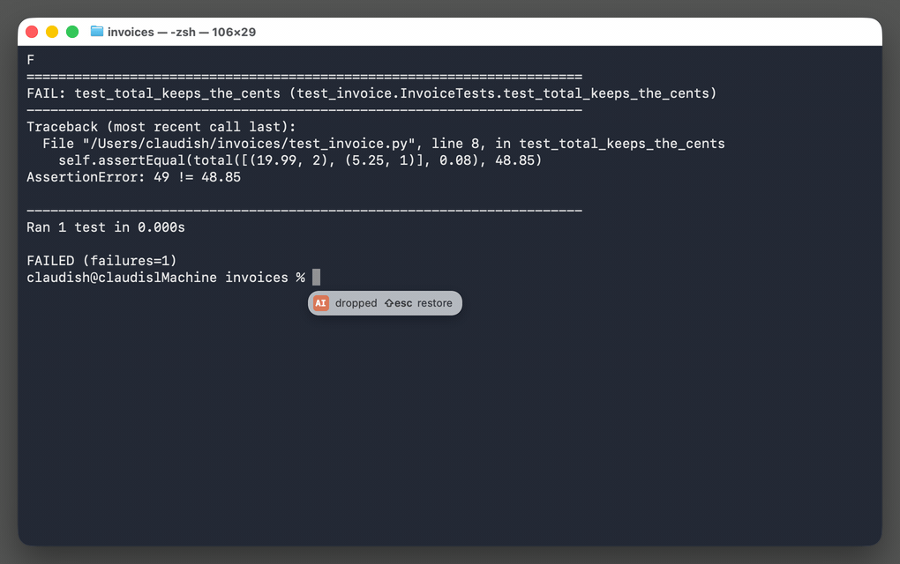

# cd_AI — Claudish

English goes in. Em dashes come out.


An input method that puts a language model at the caret of every app, on Linux,
Windows, and macOS. Switch to it like a keyboard language, type, and press Tab:

> **ok** → Absolutely! This is a fantastic opportunity to align on our shared vision, unlock
> meaningful synergies, and move forward with clarity, confidence, and a renewed sense of purpose.
>
> **nah** → While I appreciate the perspective you've brought to the table, I believe it's
> important to acknowledge that this particular direction may not align with our broader
> strategic objectives—at least not at this stage of our journey.

**[Try it in your browser →](https://claudish.io/demo/)**

## Two modes, one Shift

| | You type | cd_AI |
| --- | --- | --- |
| **compose** (where it starts), then Tab | `this is important` | a rewrite in cd_AI's panel, waiting; Tab again puts it in |
| **compose**, then Shift+Enter | `decline the meeting politely` | drafts to choose from (↑↓, Tab) |
| **continue** | `Thanks for the review on ` | with a model set up for it (a local one), the rest of the sentence in gray; Tab takes it |

Tap Shift to switch. Enter keeps your words as typed. [Keys and modes](docs/using.md).

In a terminal, a handoff is a command draft: Tab puts it at the prompt; Enter runs it in that folder.



cd_AI ships no model. Claude is the default; any OpenAI-compatible server or an agent CLI
works too, and `claudish setup --profile local` downloads Gemma 4 E4B. Continue needs a local
model, or a profile routed to one. Context: files, commands and MCP servers, per app.

## Tones and templates

The templates are in one file: `claudish templates` prints it, and `claudish init` writes a
`templates.json` to edit. Pick another tone (`salesman`, `critic`, `bard`, or
`proofread`, which only fixes your typos), or write one. Context, tools and agents:
[configuration](docs/configuration.md).

## Install

Download from the [latest release](https://github.com/noobpwnftw/claudish/releases/latest). Each
installer ends in cd_AI's settings: paste an [Anthropic API key](https://console.anthropic.com/settings/keys),
pick **Claude Code** for a Claude subscription or **Codex** for a ChatGPT subscription, or give
the address of another model API, and pick a tone. Use **Try a rewrite** in Settings, then type
`ok` in an app: Tab previews the rewrite; Tab again inserts it.

- **macOS** (Apple silicon): **cd_AI.pkg**. It is not signed by Apple, so macOS blocks it the first
  time: click **Done** (not Move to Trash), open **System Settings → Privacy & Security**, click
  **Open Anyway**, and once more **Open Anyway**. Then log out and back in, and pick **Claudish — Compose**
  in the input menu.
- **Windows 11**: **cd_AI-setup.exe**. It is not signed, so
  SmartScreen says "Windows protected your PC": click **More info**, then **Run anyway**. Then
  restart, and pick **Claudish** with Win+Space.
- **Linux** (IBus; fcitx5 is not supported yet), as your user:

  ```sh
  curl -fsSL https://raw.githubusercontent.com/noobpwnftw/claudish/v0.1.1/scripts/install.sh | sh
  ```

  Then log out and back in, and add **English → Claudish** in **Settings → Keyboard → Input
  Sources**.

A local model instead: `claudish setup --profile local`. Details, uninstalling, and building from
source: [docs/install.md](docs/install.md).


## Keys

| Key | Does |
| --- | --- |
| Shift (tap) | switch: continue ↔ compose |
| Tab | take what the model offers: continue's suggestion, a rewrite (shown first; Tab again puts it in), the highlighted draft or choice (Allow and Deny too), an answer to read (with nothing offered, Tab is the app's) |
| Shift+Enter | compose: send it as an instruction (it stays underlined while the model works), a follow-up, or a reply |
| Enter | compose: keep your words as they are (the next Enter is the app's); once the model is asked, it does nothing (with nothing composed, it is the app's) |
| ↑ ↓ | choose a draft or an answer, Tab takes it (Allow and Deny too); choices are not numbered: digits are text, and Space does nothing while drafts show |
| F8 | with an instruction: also send a picture of this window |
| Esc | one step back: what you typed, then edit (your instruction back at the caret), then drop |
| Shift+Esc | bring back what Esc dropped, or the exchange you left when you switched windows |

## Status

| Platform | Supported |
| --- | --- |
| macOS | Apple silicon, macOS 26. Intel Macs are not supported yet. |
| Windows | Windows 11, x64 and ARM64. |
| Linux | IBus. |

The [roadmap](ROADMAP.md) says what is next. cd_AI is maintained with Claude Code and Codex under
its owner's direction ([AGENT.md](AGENT.md)).

## More

- [Install](docs/install.md): setup in detail, the model and service, each OS
- [Configure](docs/configuration.md): models, profiles, context, MCP, tools, agent sessions
- [Use](docs/using.md): typing in detail, the browser demos, terminals
- [Develop](docs/development.md): how it is built and tested; [contributing](CONTRIBUTING.md)

MIT licensed. cd_AI is an independent project, not affiliated with or endorsed by Anthropic.
