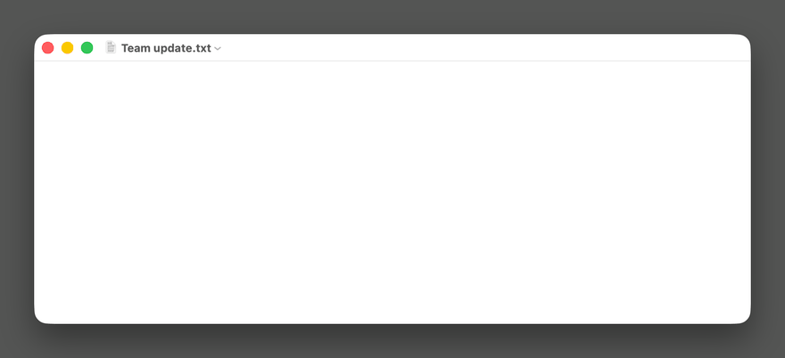

# cd_AI — Claudish

English goes in. Em dashes come out.



An input method that puts a language model at the caret of every app, on Linux,
Windows, and macOS. Switch to it like a keyboard language, type, and press Tab:

> **ok** → Absolutely! This is a fantastic opportunity to align on our shared vision, unlock
> meaningful synergies, and move forward with clarity, confidence, and a renewed sense of purpose.
>
> **nah** → While I appreciate the perspective you've brought to the table, I believe it's
> important to acknowledge that this particular direction may not align with our broader
> strategic objectives—at least not at this stage of our journey.

**[Try it in your browser →](https://claudish.io/demo/)**

## Two modes, one Shift

| | You type | cd_AI |
| --- | --- | --- |
| **compose** (where it starts), then Tab | `this is important` | a rewrite in cd_AI's panel, waiting; Tab again puts it in |
| **compose**, then Enter | `decline the meeting politely` | drafts to choose from (↑↓, Tab) |
| **continue** | `Thanks for the review on ` | the rest of the sentence, in gray; Tab takes it |

Tap Shift to switch. Shift+Enter keeps your words as typed. [Keys and modes](docs/using.md).

cd_AI ships no model. Claude is the default; any OpenAI-compatible server or an agent CLI
works too, and `claudish setup --profile local` downloads Gemma 4 E4B. Continue needs a local
model, or a profile routed to one. Context: files, commands and MCP servers, per app.

## Tones and templates

The templates are in one file: `claudish templates` prints it, and `claudish init` writes a
`templates.json` to edit. Pick another tone (`salesman`, `critic`, `bard`, or
`proofread`, which only fixes your typos), or write one. Context, tools and agents:
[configuration](docs/configuration.md).

## Install

**Linux** (IBus only, a preview; fcitx5 is not supported yet), as your user:

```sh
curl -fsSL https://raw.githubusercontent.com/noobpwnftw/claudish/main/scripts/install.sh | sh
```

It installs into `~/.local/share/claudish`, puts the `claudish` command in `~/.local/bin`, and ends
in cd_AI's settings (the key, the tone). Then log out and back in, and add **English → cd_AI —
Claudish** in **Settings → Keyboard → Input Sources**.

**macOS** (Apple silicon): the installer is `cd_AI.pkg`. Until the first release, build it on a
Mac with Python 3.10+ from python.org:

```sh
git clone https://github.com/noobpwnftw/claudish && cd claudish
python3 platforms/macos/build.py && python3 platforms/macos/package.py
open dist/macos/cd_AI.pkg
```

It installs cd_AI for you alone and ends in cd_AI's settings. Then log out and back in.
[More](docs/install.md#macos-input-method).

**Windows 11** (tested on ARM64; x64 not yet): the installer is `cd_AI-setup.exe`. Until the first release it is
built from source ([how](docs/install.md#windows-input-method)); the input method comes only from
it. It ends in cd_AI's settings; then restart, and pick cd_AI with Win+Space.

All three end in the same settings page: paste an Anthropic API key, pick **Claude Code** to use
a Claude subscription through the `claude` command, or give the address of another model API. A local model instead: `claudish setup --profile local`. Details, uninstalling, and a
source checkout for development: [docs/install.md](docs/install.md).

## Keys

| Key | Does |
| --- | --- |
| Shift (tap) | switch: continue ↔ compose |
| Tab | take the model's text: continue's suggestion, a rewrite (shown first; Tab again puts it in), the highlighted draft, an answer to read (with nothing offered, Tab is the app's) |
| Enter | compose: send it as an instruction (it stays underlined while the model works), a reply, or the answer to the model's question (with nothing composed, a newline) |
| Shift+Enter | compose: keep your words as they are (where most CJK input methods use Enter for that) |
| ↑ ↓ | choose a draft (Tab inserts it) or an answer (Enter sends it); choices are not numbered: digits are text, and Space does nothing while drafts show |
| F8 | with an instruction: also send a picture of this window |
| Esc | one step back: what you typed, then edit (your instruction back at the caret), then drop |
| Shift+Esc | bring back what Esc dropped, or the exchange you left when you switched windows |

## Status

| Platform | Supported |
| --- | --- |
| macOS | Apple silicon, macOS 26. Intel Macs are not supported yet. |
| Windows | Windows 11 ARM64; x64 builds but is not yet tested. |
| Linux | IBus, a preview. |

The first release, 0.1.0, is in preparation; the [roadmap](ROADMAP.md) says what is next. How each
platform is tested: [docs/development.md](docs/development.md#testing). cd_AI is maintained by an
AI agent (Claude Code) under its owner's direction ([AGENT.md](AGENT.md)).

## More

- [Install](docs/install.md): setup in detail, the model and service, each OS
- [Configure](docs/configuration.md): models, profiles, context, MCP, tools, agent sessions
- [Use](docs/using.md): typing in detail, the browser demos, terminals
- [Develop](docs/development.md): how it is built and tested; [contributing](CONTRIBUTING.md)

MIT licensed. cd_AI is an independent project, not affiliated with or endorsed by Anthropic.
